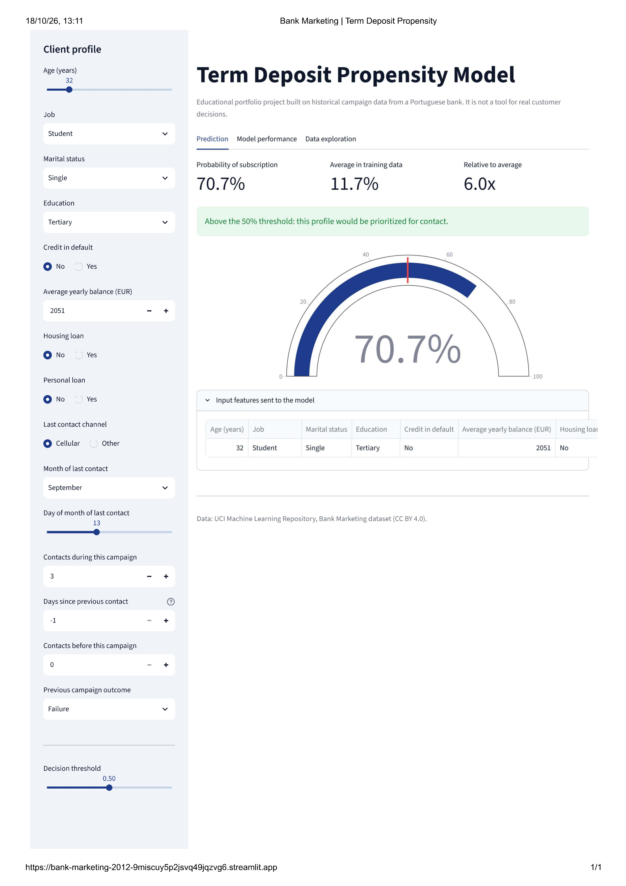

# Bank Marketing: Term Deposit Propensity Model

**[Live demo](https://bank-marketing-2012-9miscuy5p2jsvq49jqzvg6.streamlit.app/)** (the app may take a moment to load if it has been inactive)



An end-to-end machine learning project: a classification model that estimates how likely a bank client is to subscribe to a term deposit after a telemarketing campaign, deployed as an interactive Streamlit app.

## Question

Which clients are worth prioritizing in a telemarketing campaign? The model gives each client a probability of subscribing, and a decision threshold turns it into a "contact / do not prioritize" recommendation.

## Data

- Source: [Bank Marketing](https://archive.ics.uci.edu/dataset/222/bank+marketing), UCI Machine Learning Repository (CC BY 4.0). Historical campaign data from a Portuguese bank.
- About 45,000 clients, with demographic, financial and campaign variables. The target is whether the client subscribed (`y`).
- Only about 11.7% of clients subscribed, so the classes are imbalanced.

## Method

- **Data leakage:** `duration` (the call length) was excluded because it is only known after the call.
- **Preparation:** missing categories were labeled as `missing`, yes/no variables were converted to booleans, and `contact` was simplified to a cellular flag.
- **Validation:** stratified 75/25 train-test split, and 5-fold stratified cross-validation for tuning.
- **Models compared:** logistic regression and random forest, each in 6 variants (baseline, class weights, Randomized Search CV, Optuna, and class weights combined with each search).
- **Selected model:** random forest with balanced class weights tuned with Randomized Search CV.
- **Metrics:** accuracy alone is misleading with imbalanced classes, so I compared ROC-AUC, F1, recall and precision.
- **Deployment:** preprocessing and model are saved as a single scikit-learn pipeline, so the app sends raw inputs and cannot drift from training.

## Results (test set, threshold 0.50)

| Metric | Value |
|---|---|
| Accuracy | 0.87 |
| ROC-AUC | 0.80 |
| Recall | 0.54 |
| Precision | 0.44 |
| F1 | 0.49 |

Accuracy (86.6%) is lower than the 88.3% that a model that always predicts "no" would reach, because only about 11.7% of clients subscribe. The class-balanced random forest trades some accuracy for a much more useful recall (54.1%) and F1 score (48.6%): it finds just over half of the clients who actually subscribe. The ROC-AUC of 0.80 means it ranks a random subscriber above a random non-subscriber about 80% of the time. Precision is 44%, so more than half of the clients it flags will still not subscribe.

## The app

- **Prediction:** enter a client profile and see the probability, how it compares with the average, and whether it passes the decision threshold.
- **Model performance:** metrics, confusion matrix and precision-recall curve that update with the threshold, plus feature importance.
- **Data exploration:** subscription rate by variable and a scatter plot to explore the data.

## Limitations

- **Educational project.** It is built on historical data from one institution and must not be used to make real decisions about customers.
- Feature importance is impurity-based, so it shows what the model uses, not a causal effect.
- Performance on newer campaigns or other markets is unknown.

## Repository structure

```
app/            Streamlit app
models/         Trained pipeline, metadata and test scores
notebook/       Analysis and training notebook
requirements.txt
```

## Run locally

```
pip install -r requirements.txt
streamlit run app/streamlit_app.py
```

Python 3.12 was used for development and deployment.

## Data citation

Moro, S., Rita, P., & Cortez, P. (2014). Bank Marketing [Dataset]. UCI Machine Learning Repository. https://doi.org/10.24432/C5K306.

## Author

Joaquín Ignacio Muñoz Figueroa | [LinkedIn](https://www.linkedin.com/in/joaqu%C3%ADn-mu%C3%B1oz-figueroa-586a5a229)| [GitHub](https://github.com/ijoaquinmunozfig)